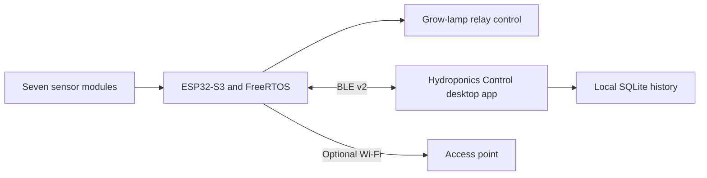

# Hydroponics Monitoring System

An ESP32-S3 controller monitors a hydroponic reservoir and its surroundings,
makes local grow-lamp and alarm decisions, and sends readings to a Windows or
Linux desktop app over Bluetooth Low Energy (BLE). The app handles sensor
setup, calibration, diagnostics, and history export. The custom PCB is
designed to keep the controller and selected sensors powered from a 3S
battery when external 5 V is lost.

## Start here

| If you want to… | Start with… |
| --- | --- |
| Explore without a board | [Install the desktop app](BluetoothControlApp/Readme.md#install-and-run) and [walk through the simulator](BluetoothControlApp/Readme.md#walk-through-the-demo). |
| Review or manufacture the PCB | Open the [Rev 1.5 PCB guide](PCB%20Design/README.md) for the schematic, connector pinout, power paths, BOM, and fabrication checks. |
| Build or flash firmware | [Build with PlatformIO](Firmware/README.md#build-and-test) and follow the [bench bring-up](Firmware/README.md#bench-bring-up). |
| Commission a controller | [Connect over BLE](BluetoothControlApp/Readme.md#connect-to-a-controller), then check sensor health, calibrate the probes, and export a sample history. |
| Work on the app or protocol | See the [app development guide](BluetoothControlApp/Readme.md#develop-and-test) and the [BLE v2 contract](BluetoothControlApp/FirmwareContract.md). |

## How it fits together

The PCB routes I²C, 1-Wire, analog inputs, and ultrasonic timing signals
to the ESP32-S3. The firmware schedules measurements and publishes a
snapshot with units, sample age, and health. A separate Safety task owns
the relay, so local control continues independently of the desktop
connection. The controller stores sensor settings and calibration in
flash. The app keeps a separate copy of the readings it receives.

BLE carries live State, Telemetry, alarms, and commissioning commands.
The Wi-Fi page configures the controller's own network connection. MQTT
publishing and a remote dashboard appear in the redesign documents as
planned work. The current system uses the BLE desktop app and local
history.

## What it measures

| Sensor | Measurements | Power branch |
| --- | --- | --- |
| BME280 | Air temperature (°C), relative humidity (% RH), and pressure (Pa) | Retained 3.3 V |
| DS18B20 | Water temperature (°C) | Retained 3.3 V |
| DFR0026 | Light signal (mV), or illuminance (lux) after reference calibration | Retained 3.3 V |
| SGP30 | Total volatile organic compounds (ppb) and estimated CO₂ equivalent (ppm) | Retained 3.3 V |
| HC-SR04 | Distance to the water surface (mm) | External 5 V |
| pH-4502C | Reservoir pH | External 5 V |
| SEN0244 | Temperature-compensated total dissolved solids (ppm) | External 5 V |

The relay interface also uses external 5 V. Firmware 0.11.0 reports the
external power state by default. The optional power handover stops 5 V
sensing and pauses Wi-Fi on rail loss. That mode still needs validation
on the assembled board. The BLE link is open and carries Wi-Fi
credentials unencrypted. [Firmware power policy](Firmware/README.md#power-and-safety-policy) · [BLE link details](BluetoothControlApp/FirmwareContract.md#bluetooth-le)

## Design references and project history

- The October redesign defines the system requirements and validation
  plan. The SysML package maps requirements to components, interfaces,
  and test cases. [Redesign specification, Rev 5](Documentation/Redesign%20Specification.pdf) · [SysML diagrams](Documentation/SysML%20Diagrams.pdf)
- The firmware architecture records module boundaries and design
  decisions. Its RTOS companion explains tasks, scheduling, and
  supervision. The guided textbook walks through a snapshot of the
  implementation. [Firmware architecture](Firmware/Firmware%20Architecture.pdf) · [RTOS architecture](Firmware/RTOS%20Architecture.pdf) · [Guided firmware textbook](Documentation/Hydroponics%20Firmware.pdf)
- The dated bench notes preserve the earlier development-board and
  breadboard results. Use the Rev 1.5 schematic and connector guide when
  wiring the custom PCB. [Bench notes](Firmware/docs/bench-notes.md) · [PCB guide](PCB%20Design/README.md)
- The original handover documents the earlier ESP32, EdgeX, and MQTT
  prototype. The provenance document records the current firmware and app
  source, attribution, and license scope. [Original handover](Project%20Handover/Source%20Code/HANDOVER.md) · [Provenance](PROVENANCE.md)
